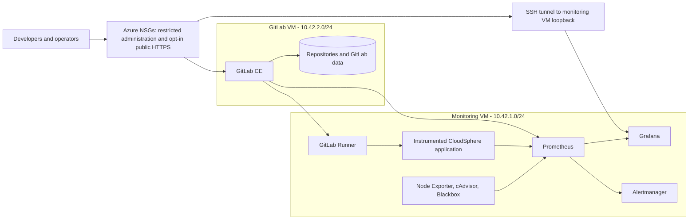

# Internal GitLab and Observability Platform

This repository combines two complete internal-platform capabilities on Microsoft Azure:

1. A self-managed GitLab Community Edition service for repositories, merge requests, code review, CI/CD pipelines, and controlled software delivery.
2. A Prometheus and Grafana observability service for host, container, endpoint, GitLab, runner, application, and business metrics.

Terraform creates two Ubuntu virtual machines in one secured virtual network. Docker Compose runs GitLab on the GitLab VM and the monitoring services plus GitLab Runner on the monitoring VM. Bash scripts provide repeatable deployment, health checking, backup, recovery, and teardown procedures.

## Why the combined project is useful

The platform gives an engineering team one workflow from source code to operations:

1. A developer pushes a branch to the internal GitLab repository.
2. A merge request provides review and change visibility.
3. GitLab Runner executes formatting, syntax, unit, Compose, Terraform, and secret checks.
4. An authorized manual deployment job updates the monitoring environment.
5. Prometheus records the health of GitLab, Runner, Azure host, containers, endpoints, and the CloudSphere application.
6. Grafana presents the signals in provisioned dashboards.
7. Alertmanager routes meaningful infrastructure, GitLab, and business alerts.

## Implemented architecture



The detailed design is in [docs/ARCHITECTURE.md](docs/ARCHITECTURE.md). The requirements mapping is in [docs/PROJECT_REQUIREMENTS_MATRIX.md](docs/PROJECT_REQUIREMENTS_MATRIX.md).

## Main components

| Component | Purpose |
|---|---|
| Microsoft Azure | Hosts the virtual network, security controls, public IPs, disks, and two Linux VMs. |
| Terraform | Declares and provisions the Azure infrastructure reproducibly. |
| Ubuntu Linux | Provides the secured operating-system environment for both VMs. |
| Docker Compose | Starts GitLab and the monitoring stack from version-controlled definitions. |
| GitLab CE | Hosts repositories, branches, merge requests, users, and pipelines. |
| GitLab Runner | Executes CI/CD jobs with the Docker executor on the separate monitoring VM. |
| Prometheus | Scrapes, stores, queries, and evaluates technical and business metrics. |
| Grafana | Provides automatically provisioned operations and GitLab dashboards. |
| Alertmanager | Groups, inhibits, routes, and resolves alerts. |
| Node Exporter and cAdvisor | Export both Linux hosts and the monitoring VM's Docker container resource metrics. |
| Blackbox Exporter | Independently probes HTTP health endpoints, including GitLab. |
| Python CloudSphere application | Produces testable order, revenue, inventory, error, and webhook metrics. |
| Bash and cloud-init | Automate installation, deployment, checks, backups, and lifecycle operations. |

## Resource-sizing note

The example uses two `Standard_D2ads_v7` VMs so it can fit a small training subscription with a four-vCPU regional quota. The GitLab VM therefore represents a constrained training environment, not production sizing. The Compose configuration applies GitLab's low-memory Puma, Sidekiq, Gitaly, and exporter recommendations. Current [GitLab installation requirements](https://docs.gitlab.com/install/requirements/) use an 8-vCPU/16-GB baseline for a normal single-node deployment; GitLab separately documents a [small-team constrained configuration](https://docs.gitlab.com/omnibus/settings/memory_constrained_envs/). Increase `gitlab_vm_size`, disk capacity, and subscription quota before production use.

Check availability before deployment:

```bash
az vm list-skus \
  --location uaenorth \
  --resource-type virtualMachines \
  --all \
  --query "[?length(restrictions)==\`0\` && starts_with(name,'Standard_D')].{Name:name,vCPUs:capabilities[?name=='vCPUs'].value|[0],MemoryGB:capabilities[?name=='MemoryGB'].value|[0]}" \
  -o table
```

## Deploy the complete platform

### 1. Prerequisites

Use Linux, Kali, or WSL with:

- Terraform 1.8 or later
- Azure CLI
- Bash, OpenSSH, and `tar`
- An Azure subscription with enough regional vCPU quota
- An Ed25519 or RSA SSH public key
- Your trusted public IPv4 address with `/32`

Authenticate first:

```bash
az login
az account set --subscription "SUBSCRIPTION_ID_OR_NAME"
```

### 2. Configure Terraform

```bash
cp terraform/terraform.tfvars.example terraform/terraform.tfvars
```

Edit `terraform/terraform.tfvars`:

- Replace `admin_source_cidr` with your public IP plus `/32`.
- Add additional trusted team ranges to `gitlab_access_cidrs`, if required.
- Replace either VM SKU if it is unavailable in your subscription.
- Keep both access lists restricted. Terraform rejects `0.0.0.0/0`.

The `cloudsphere-lab` naming in the example is for new infrastructure. Do not run `terraform apply` merely to change Azure names on an existing installation. Azure resource-group and VM names cannot be changed in place; migrate them only after verified backups, disk snapshots, state recovery, capacity checks, and a planned cutover.

### 3. Deploy

```bash
chmod +x scripts/*.sh stack/scripts/*.sh gitlab/scripts/*.sh
./scripts/deploy-azure.sh
```

The script:

1. Formats, initializes, validates, plans, and applies Terraform.
2. Waits for SSH and cloud-init on both VMs.
3. Uploads and starts GitLab CE.
4. Uploads the monitoring stack.
5. Generates private GitLab application, health, and host-metrics targets from Terraform outputs.
6. Starts Prometheus, Grafana, Alertmanager, exporters, the CloudSphere application, and Runner.
7. Runs GitLab and monitoring health checks.

GitLab's first initialization can take 10-20 minutes. Do not interrupt the deployment while the health check is waiting.

## Access the services

Terraform prints the live commands. You can display them again with:

```bash
terraform -chdir=terraform output
```

### GitLab

Open the restricted `gitlab_url` output. The initial username is `root`.

Retrieve the generated initial password:

```bash
ssh azureadmin@GITLAB_PUBLIC_IP \
  cat /opt/gitlab-stack/secrets/gitlab_root_password.txt
```

Rotate it after the first login. Git repository SSH is exposed on port `2222`, separately from host administration on port `22`.

### Grafana

Open the private SSH tunnel returned by `grafana_ssh_tunnel_command`, then browse to the local `grafana_url` output. The username is `admin`.

```bash
ssh azureadmin@MONITORING_PUBLIC_IP \
  sudo cat /opt/monitoring/secrets/grafana_admin_password.txt
```

### Prometheus and Alertmanager

Keep both administrative interfaces private and use SSH tunnels:

```bash
ssh -L 9090:127.0.0.1:9090 azureadmin@MONITORING_PUBLIC_IP
ssh -L 9093:127.0.0.1:9093 azureadmin@MONITORING_PUBLIC_IP
```

### Optional public CloudSphere status page

The opt-in Caddy profile publishes only the read-only CloudSphere status page at `https://www.cloudsphere-sda.online/`. The operator console and all monitoring administration remain private. Follow [docs/PUBLIC_ACCESS.md](docs/PUBLIC_ACCESS.md) for the Namecheap record, Azure ingress gate, activation, verification, and rollback procedure.

## Create the internal project and register Runner

1. Sign in to the self-managed GitLab instance.
2. Create a group and a blank project.
3. Open **Settings > CI/CD > Runners**, create a project runner, and copy its `glrt-` authentication token.
4. Register the runner from the monitoring VM:

   ```bash
   ssh azureadmin@MONITORING_PUBLIC_IP
   cd /opt/monitoring
   RUNNER_AUTH_TOKEN='PASTE_GLRT_AUTHENTICATION_TOKEN' ./scripts/register-runner.sh
   ```

   The script uses GitLab's private VNet URL for Runner polling and repository cloning. Browsers and developers continue to use the restricted public URL.

5. Point the local repository at the new internal project and push:

   ```bash
   git remote add internal http://GITLAB_PUBLIC_IP/GROUP/PROJECT.git
   git push -u internal main
   ```

Runner registration and CI/CD variables are documented in [docs/GITLAB.md](docs/GITLAB.md).

## Pipeline behavior

The root `.gitlab-ci.yml` provides:

- Terraform formatting and provider-backed validation
- ShellCheck for all automation scripts
- Python syntax and unit tests
- Grafana dashboard JSON validation
- Default, public-profile, and GitLab Docker Compose model validation
- Caddy configuration validation without starting HTTPS or requesting a certificate
- GitLab secret detection
- A protected manual deployment job for the monitoring stack

The manual deployment requires masked/protected CI/CD variables described in [docs/GITLAB.md](docs/GITLAB.md). It intentionally never creates or destroys Azure infrastructure automatically.

## Present the monitoring lifecycle

Open the browser-based **CloudSphere Operations Console** through the monitoring tunnel:

```text
http://127.0.0.1:8000
```

The presentation console can:

- create a custom order or three prepared orders;
- restock the simulated inventory;
- generate one controlled error or a complete 20-error alert sequence;
- start or stop a real, container-capped 30-second CPU load test;
- display the current orders, revenue, inventory, and error counters;
- reset all CloudSphere values; and
- open Grafana, Prometheus Alerts, and Alertmanager in separate tabs.

Keep CloudSphere and the **CloudSphere — Infrastructure Command Center** Grafana dashboard side by side. CloudSphere owns the presentation controls; Grafana shows the resulting Azure host, container, network, storage, target, and alert signals. The shortcut opens a live fifteen-minute view with a two-second refresh.

The original HTTP endpoints remain available as an operator fallback on the monitoring VM:

```bash
cd /opt/monitoring
curl "http://127.0.0.1:8000/simulate/order?amount=125.50&quantity=2"
curl "http://127.0.0.1:8000/simulate/restock?quantity=50"
curl -i "http://127.0.0.1:8000/simulate/error"
```

Open these provisioned Grafana dashboards:

- **CloudSphere — Infrastructure Command Center**
- **CloudSphere — GitLab Control Plane**

The Infrastructure Command Center summarizes both Azure hosts with availability, fast host CPU, memory, root-disk use, uptime, load averages, network and disk throughput, container CPU and memory, Prometheus target state, HTTP endpoint health, and pending or firing platform alerts. Controlled presentation alerts are included while passive order and inventory reminders are excluded. Its cyan, blue, violet, green, amber, and red signals follow the CloudSphere identity while preserving familiar operational severity colors.

The GitLab Control Plane applies the same CloudSphere visual system to the self-managed GitLab service, HTTP health endpoint, Runner, GitLab VM telemetry, host capacity, network and disk throughput, scrape quality, target status, and GitLab-scoped alert pipeline.

Return CloudSphere business values to their initial state:

```bash
curl -X POST http://127.0.0.1:8000/simulate/reset
```

Prometheus may need one or two scrape intervals and Grafana may need one refresh before the zero values appear.

## Stop and reopen

Stop only the application containers while preserving data:

```bash
# GitLab VM
cd /opt/gitlab-stack
docker compose --env-file .env stop

# Monitoring VM
cd /opt/monitoring
docker compose --env-file .env stop
```

Reopen them later:

```bash
# GitLab VM
cd /opt/gitlab-stack
docker compose --env-file .env start
./scripts/health-check.sh --wait

# Monitoring VM
cd /opt/monitoring
docker compose --env-file .env start
./scripts/health-check.sh
```

Azure auto-shutdown stops the VMs without deleting disks. Start both VMs from Azure, wait for SSH, and run the same Compose `start` commands if Docker did not restore them automatically.

## Repository structure

```text
terraform/              Azure VNet, NSGs, public IPs, two VMs, and shutdown schedules
gitlab/                 Self-managed GitLab Compose stack, secrets, health, backup, restore
stack/                  Prometheus/Grafana stack, GitLab Runner, exporters, and CloudSphere app
scripts/                Combined Azure deployment, validation, and safe teardown
docs/                   Architecture, GitLab, security, tests, operations, and requirements
.gitlab-ci.yml           Validate, test, secret-detection, and manual deployment pipeline
```

## Project documentation

- [Architecture and data flow](docs/ARCHITECTURE.md)
- [GitLab setup, Runner registration, and CI/CD variables](docs/GITLAB.md)
- [Operations and recovery runbook](docs/OPERATIONS_RUNBOOK.md)
- [Security review](docs/SECURITY.md)
- [Requirements traceability matrix](docs/PROJECT_REQUIREMENTS_MATRIX.md)
- [Test and acceptance plan](docs/TEST_PLAN.md)
- [Guided implementation presentation](docs/PRESENTATION_GUIDE.md)
- [CloudSphere browser controls and deployment](docs/CLOUDSPHERE_CONTROL.md)
- [Public DNS, HTTPS, security boundary, and rollback](docs/PUBLIC_ACCESS.md)
- [Build validation summary](docs/VALIDATION_SUMMARY.md)

## Production evolution

This implementation is a deployable training and proof-of-concept platform. Before production:

- Use DNS and trusted TLS certificates for GitLab and Grafana.
- Meet GitLab's current CPU, memory, SSD, and storage baseline.
- Use organizational identity, MFA, role governance, and protected branches.
- Place services behind private connectivity, VPN, or an application gateway.
- Move secrets to Azure Key Vault or another managed store.
- Use encrypted remote Terraform state with locking.
- Schedule encrypted off-VM backups and test exact-version restoration.
- Pin container image digests and scan them before deployment.
- Separate Runner capacity and restrict Docker-socket access.
- Establish availability, capacity, recovery-time, and recovery-point objectives.

## Official references

- [GitLab: Install in Docker](https://docs.gitlab.com/install/docker/installation/)
- [GitLab: Installation requirements](https://docs.gitlab.com/install/requirements/)
- [GitLab: Register runners](https://docs.gitlab.com/runner/register/)
- [GitLab: Health checks](https://docs.gitlab.com/administration/monitoring/health_check/)
- [GitLab: External Prometheus monitoring](https://docs.gitlab.com/administration/monitoring/prometheus/)
- [GitLab: Docker backups](https://docs.gitlab.com/install/docker/backup/)
- [Microsoft: Terraform Linux VM](https://learn.microsoft.com/en-us/azure/virtual-machines/linux/quick-create-terraform)
- [Docker: Compose file reference](https://docs.docker.com/compose/compose-file/)
- [Prometheus: Configuration](https://prometheus.io/docs/prometheus/latest/configuration/configuration/)
- [Grafana: Provisioning](https://grafana.com/docs/grafana/latest/administration/provisioning/)
