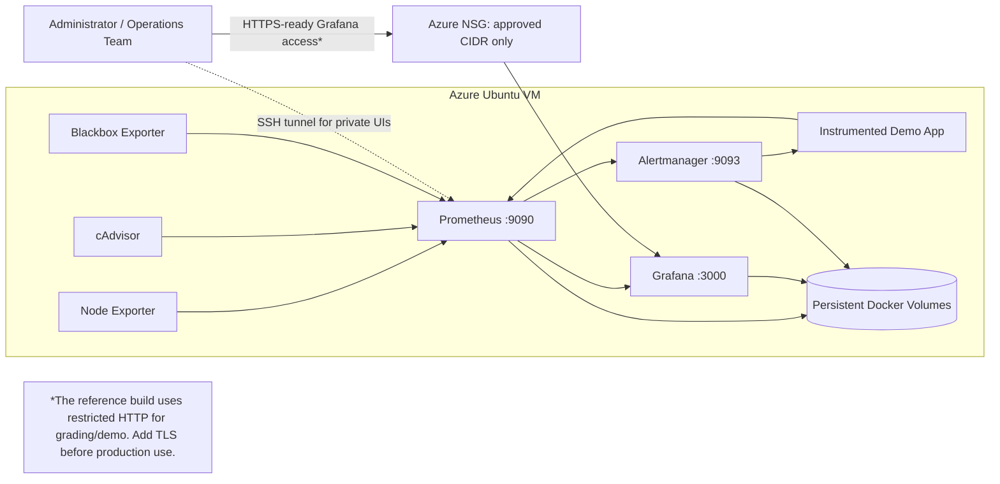

# Internal Monitoring and Observability Platform

This project implements the brief for **RCP #13 - Prometheus and Grafana** as a complete Azure reference deployment. Terraform creates the secured Azure infrastructure, Bash automates installation and deployment, and Docker Compose runs a version-controlled monitoring stack with persistent data, dashboards, alerting, and a metrics-enabled demonstration service.

## What the project delivers

- Azure resource group, virtual network, subnet, static public IP, network security group, Linux VM, managed identity, boot diagnostics, and optional daily shutdown schedule.
- Restricted public access: SSH and Grafana accept traffic only from the administrator CIDR; Prometheus and Alertmanager bind to VM localhost by default.
- Prometheus metric collection for the host, Docker containers, the monitoring platform, endpoint uptime, and a demonstration business service.
- Grafana provisioning as code: the Prometheus data source and an operations dashboard load automatically at startup.
- Prometheus recording and alerting rules for availability, CPU, memory, disk, container pressure, application errors, inventory, and business inactivity.
- Alertmanager grouping and inhibition with a local demonstration webhook. The runbook explains how to replace it with an organizational notification channel.
- Persistent volumes, log rotation, health checks, a backup script, an operations runbook, and an acceptance test plan.

## Architecture



The detailed design and production evolution path are documented in [docs/ARCHITECTURE.md](docs/ARCHITECTURE.md).

## Component versions

Versions were checked against official release channels on 23 August 2026 and are pinned in `stack/.env.example`.

| Component | Version | Role |
|---|---:|---|
| Prometheus | 3.13.1 LTS | Time-series collection, recording rules, and alerts |
| Alertmanager | 0.33.1 | Alert grouping, inhibition, and notification routing |
| Grafana OSS | 13.1.0 | Dashboards and metric exploration |
| Node Exporter | 1.12.1 | Linux host metrics |
| Blackbox Exporter | 0.28.0 | HTTP endpoint probing |
| cAdvisor | 0.60.5 | Docker container resource metrics |
| AzureRM provider | 4.76.x | Azure resource provisioning |

## Quick start: local demonstration

Prerequisites: Linux, Docker Engine with Compose v2, Bash, `curl`, and OpenSSL. On Windows, use WSL 2 or a Linux VM.

```bash
cd stack
chmod +x scripts/*.sh
./scripts/deploy-local.sh
```

Open Grafana at `http://localhost:3000`. The user is `admin`; retrieve the generated password with:

```bash
cat secrets/grafana_admin_password.txt
```

Prometheus and Alertmanager are intentionally local-only:

- Prometheus: `http://localhost:9090`
- Alertmanager: `http://localhost:9093`
- Demo service: `http://localhost:8000`

## Azure deployment

### 1. Prepare the workstation

Install Terraform 1.8 or later, Azure CLI, Bash, OpenSSH, and `tar`. Authenticate and select the correct subscription:

```bash
az login
az account set --subscription "YOUR_SUBSCRIPTION_ID_OR_NAME"
```

Create an SSH key if needed:

```bash
ssh-keygen -t ed25519 -C "azure-monitoring-admin"
```

### 2. Configure Terraform

```bash
cp terraform/terraform.tfvars.example terraform/terraform.tfvars
```

Edit `terraform/terraform.tfvars` and replace the documentation CIDR with the administrator's real public IP plus `/32`. The configuration rejects `0.0.0.0/0` to prevent accidental open access.

### 3. Deploy infrastructure and services

```bash
chmod +x scripts/*.sh stack/scripts/*.sh
./scripts/deploy-azure.sh
```

The script validates Terraform, shows an execution plan, asks for approval, creates the Azure resources, waits for cloud initialization, securely transfers the stack, starts the containers, and runs health checks.

### 4. Access the platform

The deployment prints the Grafana URL. Retrieve the generated password without copying it into source control:

```bash
ssh azureadmin@PUBLIC_IP sudo cat /opt/monitoring/secrets/grafana_admin_password.txt
```

Keep Prometheus private and use the Terraform output to create a tunnel:

```bash
terraform -chdir=terraform output -raw prometheus_tunnel_command
```

Run the printed command and browse to `http://localhost:9090`.

## Demonstrate end-to-end monitoring

On the VM, create business activity and controlled failures:

```bash
curl "http://127.0.0.1:8000/simulate/order?amount=125.50&quantity=2"
curl "http://127.0.0.1:8000/simulate/restock?quantity=50"
curl -i "http://127.0.0.1:8000/simulate/error"
```

Then open **Internal Platform / Internal Monitoring - Operations Overview** in Grafana. The order, revenue, inventory, HTTP status, resource usage, endpoint status, and alert panels update automatically.

Run the automated service check at any time:

```bash
cd /opt/monitoring
./scripts/health-check.sh
```

The full acceptance procedure and evidence checklist are in [docs/TEST_PLAN.md](docs/TEST_PLAN.md). The checks completed in the build workspace, and the environment-dependent checks that remain, are recorded in [docs/VALIDATION_SUMMARY.md](docs/VALIDATION_SUMMARY.md).

GitLab repository setup, CI/CD validation jobs, and secret-handling guidance are documented in [docs/GITLAB.md](docs/GITLAB.md).

## Day-two operations

Common commands:

```bash
cd /opt/monitoring
docker compose ps
docker compose logs --tail=200 prometheus
docker compose restart grafana
./scripts/backup.sh
```

Incident response, backup, upgrade, and recovery instructions are in [docs/OPERATIONS_RUNBOOK.md](docs/OPERATIONS_RUNBOOK.md). Security controls and known production gaps are in [docs/SECURITY.md](docs/SECURITY.md).

## Project structure

```text
terraform/              Azure infrastructure as code and cloud-init
scripts/                Azure deployment, validation, and safe teardown
stack/                  Docker Compose monitoring platform
  prometheus/           Scrape configuration, recording rules, alerts
  alertmanager/         Alert routing and inhibition
  grafana/              Provisioned data source and dashboard
  blackbox/             HTTP probe configuration
  demo-app/             Dependency-free instrumented business service
  scripts/              Local deployment, health, secrets, and backup
docs/                   Architecture, operations, security, validation, and tests
```

## Scope and production note

This is a complete, deployable reference implementation for a training or internal proof-of-concept environment. A production rollout should add TLS and organizational identity, a private access path or reverse proxy, remote Terraform state, Azure Key Vault, off-VM backups, external notification integration, tested capacity targets, and a highly available or managed metrics architecture.

## Official references

- [Microsoft: Use Terraform to create a Linux VM](https://learn.microsoft.com/en-us/azure/virtual-machines/linux/quick-create-terraform)
- [HashiCorp: Azure Terraform tutorials](https://developer.hashicorp.com/terraform/tutorials/azure-get-started)
- [Terraform Registry: AzureRM Linux virtual machine](https://registry.terraform.io/providers/hashicorp/azurerm/latest/docs/resources/linux_virtual_machine)
- [Prometheus: Installation with Docker](https://prometheus.io/docs/prometheus/latest/installation/)
- [Prometheus: Configuration](https://prometheus.io/docs/prometheus/latest/configuration/configuration/)
- [Prometheus: Recording and alerting rules](https://prometheus.io/docs/prometheus/latest/configuration/recording_rules/)
- [Prometheus: Alerting overview](https://prometheus.io/docs/alerting/latest/overview/)
- [Grafana: Provision data sources and dashboards](https://grafana.com/docs/grafana/latest/administration/provisioning/)
- [Docker: Compose file reference](https://docs.docker.com/compose/compose-file/)
- [Docker: Manage secrets in Compose](https://docs.docker.com/compose/how-tos/use-secrets/)
