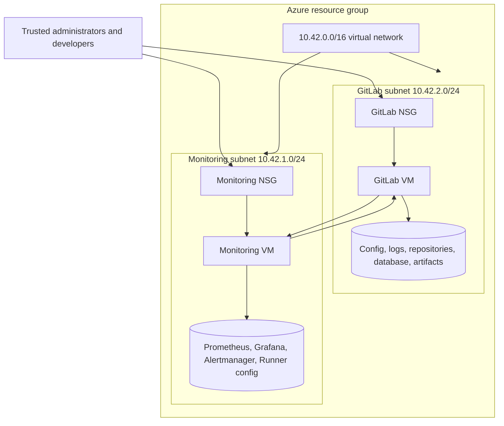

# Combined Platform Architecture

## 1. Design goal

The platform joins internal software delivery and operational observability in one repeatable Azure environment. GitLab hosts source code, collaboration, merge requests, and pipelines. A separate monitoring workload collects the health of GitLab, Runner, Linux, Docker, endpoints, and the CloudSphere business service.

## 2. Deployment model

| Layer | Implementation | Responsibility |
|---|---|---|
| Azure foundation | One resource group, one VNet, two subnets, two NSGs, two static public IPs | Isolation, restricted ingress, routing, identity, disks, and lifecycle |
| GitLab VM | Ubuntu 24.04, Docker Compose, GitLab CE, Node Exporter | Repositories, branches, merge requests, users, CI orchestration, artifacts, and host telemetry |
| Monitoring VM | Ubuntu 24.04, Docker Compose | Runner, Prometheus, Grafana, Alertmanager, exporters, the CloudSphere application, and an optional public Caddy proxy |
| Infrastructure as code | Terraform and cloud-init | Repeatable Azure provisioning and host bootstrap |
| Operations automation | Bash | Deployment, secrets, health checks, Runner registration, backup, restore, and teardown |

The two-VM split follows the operational principle that CI workers should not compete directly with the GitLab application. For the training subscription, Runner shares the monitoring VM. Production should normally provide dedicated, autoscaled Runner capacity.

## 3. Azure topology

## 4. Network boundaries

| Path | Exposure | Control |
|---|---|---|
| GitLab host SSH, TCP 22 | GitLab public IP | `admin_source_cidr` only |
| GitLab HTTP/HTTPS, TCP 80/443 | GitLab public IP | `gitlab_access_cidrs`, falling back to the administrator CIDR |
| Git repository SSH, TCP 2222 | GitLab public IP | Same trusted GitLab CIDRs |
| Grafana, TCP 3000 | Monitoring VM loopback | SSH tunnel only |
| Monitoring host SSH, TCP 22 | Monitoring public IP | Administrator CIDR only |
| Public CloudSphere HTTPS, TCP 80/443 | Monitoring public IP | Optional Internet rule; Caddy exposes only the read-only allowlist |
| Prometheus, TCP 9090 | Monitoring VM loopback | SSH tunnel only by default |
| Alertmanager, TCP 9093 | Monitoring VM loopback | SSH tunnel only |
| CloudSphere service, TCP 8000 | Monitoring VM loopback | Local presentation traffic only |
| GitLab metrics, health, and Node Exporter | Private VNet | GitLab monitoring allowlist includes `10.42.0.0/16`; the GitLab NSG has no public exporter rule |
| Exporters and Runner metrics | Monitoring Docker network | No Azure public rule |

Azure NSGs retain the default VNet-to-VNet allowance, so Prometheus can reach GitLab's private address without opening metrics endpoints to the internet.

## 5. Git and CI/CD flow

1. A developer pushes a feature branch to self-managed GitLab.
2. GitLab creates a pipeline for the commit or merge request.
3. GitLab Runner on the monitoring VM starts isolated Docker executor containers.
4. Validation jobs check Terraform, Bash, Python, unit tests, dashboards, Compose models, and committed secrets.
5. A reviewer evaluates the merge request and pipeline result.
6. The default branch exposes a protected manual deployment job.
7. The deployment job transfers only the monitoring stack to the authorized monitoring VM and runs its idempotent deployment script.
8. Infrastructure apply and destroy remain explicit operator actions outside CI.

## 6. Monitoring flow

1. Prometheus scrapes its own service, both Linux hosts, cAdvisor, Blackbox Exporter, the CloudSphere application, GitLab Runner, and GitLab's `/-/metrics` endpoint.
2. Blackbox Exporter independently probes GitLab `/-/health` along with monitoring-service health endpoints.
3. Recording rules calculate host utilization, application error ratios, and GitLab availability ratios.
4. Alert rules cover target loss, HTTP probe failures, host pressure, container pressure, GitLab availability, Runner availability, application errors, inventory, and order inactivity.
5. Alertmanager groups and routes alerts to the included CloudSphere webhook.
6. Grafana loads the data source and both dashboards automatically from version-controlled JSON.

## 7. Persistence

### GitLab VM

The Compose stack bind-mounts:

- `/srv/gitlab/config` to `/etc/gitlab`
- `/srv/gitlab/logs` to `/var/log/gitlab`
- `/srv/gitlab/data` to `/var/opt/gitlab`

This preserves configuration, secrets, repositories, PostgreSQL data, Redis data, uploads, artifacts, and application backups across container replacement.

### Monitoring VM

Named volumes preserve Prometheus, Grafana, Alertmanager, and GitLab Runner configuration. Configuration files and dashboards remain in `/opt/monitoring` and are version controlled.

## 8. Security decisions

- SSH keys only; Linux password authentication is disabled.
- Terraform rejects unrestricted `0.0.0.0/0` administrator or GitLab access.
- GitLab and Grafana authentication are mandatory.
- Initial passwords are generated on their target hosts and ignored by Git.
- GitLab metrics are allowed only from loopback and the private VNet.
- Prometheus and Alertmanager stay loopback-only.
- The optional public profile places Caddy and a dedicated `PUBLIC_ONLY` application process on an isolated edge network. It exposes only the read-only page, branded asset, health, and sanitized status API; operational and monitoring routes remain private on a separate network.
- Runner registration and deployment keys are never stored in the repository.
- The CI deployment is manual and restricted to the default branch.
- Restore and destroy scripts require explicit confirmation.

## 9. Availability and production evolution

The reference design is intentionally single-node for each platform capability and is not highly available. Its training-sized GitLab profile applies GitLab's documented Puma, Sidekiq, Gitaly, and memory-allocation adjustments and disables unused bundled exporters while keeping the externally scraped application metrics endpoint. Production evolution should add DNS and TLS, private connectivity, managed secrets, remote Terraform state, tested off-VM backups, dedicated Runner capacity, image digest pinning, vulnerability scanning, organizational identity, audit retention, and a capacity model based on measured GitLab requests, repository size, pipeline concurrency, Prometheus series, and dashboard use.
